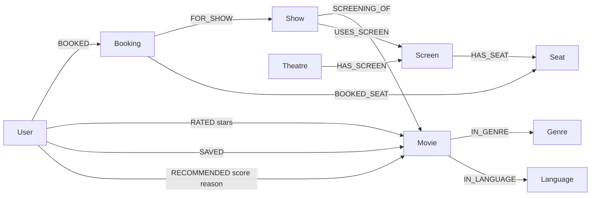

# CineScope graph model

Nine domain labels: User, Movie, Genre, Language, Theatre, Screen, Seat, Show, Booking. Every domain node also has the `CineScope` namespace label and a globally unique, CS-prefixed `id`. Authentication uses an internal `CineSession` label. `CineAccount` supports email uniqueness. A `DemoDataset` marker makes the import idempotent. These technical labels are not additional business entities.

| Entity | Main properties |
| --- | --- |
| User | id, name, email, passwordHash, demo, createdAt |
| Movie | id, title, year, duration, rating, director, description, art, color, tagline |
| Genre | id, name |
| Language | id, name |
| Theatre | id, name, city, state |
| Screen | id, name, capacity |
| Seat | id, number, row, column, type |
| Show | id, startTime, ticketPrice |
| Booking | id, status, tickets, amount, createdAt, paymentMethod, paymentStatus, cancelledAt |

`RATED` carries stars and updatedAt. `SAVED` carries createdAt. `RECOMMENDED` carries score, reason, and generatedAt. Booking status is CONFIRMED or CANCELLED; payment status is SIMULATED_PAID or SIMULATED_REFUND.

| DA1/DA2 record | Graph mapping |
| --- | --- |
| USERS | User; passwords become hashes and sessions are technical nodes |
| MOVIE | Movie |
| MOVIE_GENRE | Genre and IN_GENRE edges |
| MOVIE_LANGUAGE | Language and IN_LANGUAGE edges |
| THEATRE | Theatre |
| SCREEN | Screen and HAS_SCREEN edges |
| SEAT composite key | Seat.id combines the screen and seat number |
| MOVIE_SHOW | Show with SCREENING_OF and USES_SCREEN |
| BOOKING_PAYMENT | Booking retains combined simulated payment properties |
| RECOMMENDATION | Derived query results; optional RECOMMENDED snapshot edges |

Each booking belongs to one user and one show and connects to one or more seats in that show's screen. Each show belongs to one screen and screens one movie. A screen belongs to one theatre; a seat belongs to one screen. Movies may belong to many genres, and users may rate many movies. Required fields, cardinality, rating bounds, future shows, seat membership, and cancellation rules are enforced by the backend. Neo4j uniqueness constraints alone do not enforce these rules.

Recommendation ranking: `min(60, 12 × matched liked-movie/genre paths) + min(30, 10 × distinct similar viewers) + catalogue rating`. Liked means a personal rating of 4 or 5. All personally rated films are excluded. Ties use catalogue rating descending, then title ascending. With no liked paths or similar viewers, the catalogue rating determines the ranking. Scores range from 0 to 100 and are not probabilities.
